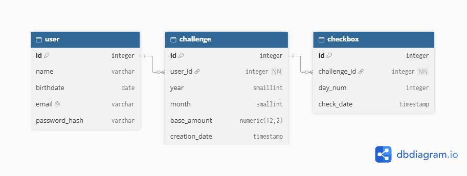

# Bienvenido a la aplicación de ahorro rutinario 🕑

Esta aplicación fue desarrollada con la intención inicial del desarrollador de ayudarse a si mismo a generar el **habito de ahorrar** frecuentemente y de paso usarlo para probar sus habilidades de desarrollo.

La función principal de la app es mediante un calendario cumplir retos de ahorro de dinero, todo en base a la cantidad que el usuario desee ahorrar.

La aplicación tendra login, permitiendo el acceso a una cuenta personal de cada usuario aunque tambien permite usarse sin iniciar sesion, podra generar notificaciones para tener al usuario pendiente de sus habitos de ahorro,

---

## Historias de usuario🧍‍♂️

**MVP 🥇:**
Como usuario quiero crear un reto de ahorro eligiendo mes y monto base.

Como usuario quiero tener la opción de marcar los montos que he ahorrado a lo largo del mes para tener un registro consciente de mis ahorros. 

Como usuario quiero tener la opción de modificar las metas de ahorro para cumplir mis expectativas.

Como usuario quiero poder desmarcar una casilla que marque por error.

Como usuario quiero ver cuanto llevo ahorrado frente a la meta.

###
---

## Modelo Entidad Relación:

###
---

## **Proximas versiones:**
Como usuario quiero tener la opción de entrar a mi cuenta desde otros dispositivos para tener acceso a mis datos.

Como usuario quiero que mis datos y estadisticas de ahorro se guarden para no perder mi progreso.

Como usuario quiero ver el historial de meses anteriores.

Como usuario quiero recibir un recordatorio diario para ahorrar.

###
---